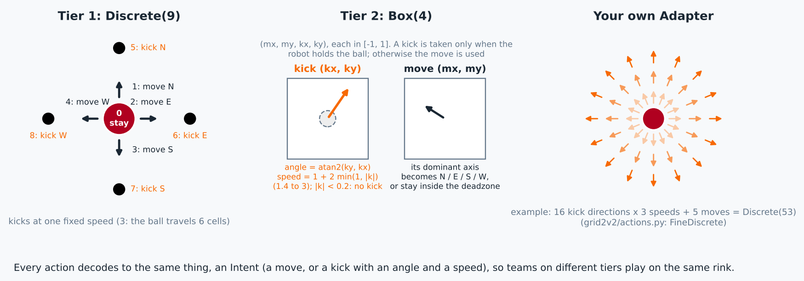

# ROBO-SOCCER

AI-Explorations 547/647 Term Project

## Overview

You will build a team of two robots that plays a 2v2 soccer game on a walled grid, and you will submit two things:
your code repository as a zip and an IEEE-style report.

Everything you need is in `project_student.zip`: the arena (`arena/`, with its README as the rulebook and
`arena/teams/README.md` for how a team folder is put together), helper scripts (`arena/tools/`: a wrapper that trains
the pair with Stable-Baselines3, single-robot environments, and exporters that turn a trained model into a team folder),
and this document.

> **AI use.** AI assistance follows the course rule for the homeworks' Phase 2: allowed for code, disclosed in the
> README's AUTHORSHIP section with the tools and prompts; **not allowed for the report's text, which is your own.**
> Code you did not write, from any source, is still code you must be able to explain.

## The game

Two teams of two robots on a 21 by 11 grid with walls. Each team attacks a three-cell goal on the far wall. A match
is 600 time steps with the team with more goals winning the match. Each step, every robot either stays, moves one
cell, or kicks the ball if it holds it; the ball flies before the robots move, slows one cell per step, bounces off
walls, and is taken by the first robot in its path.

Carrying the ball is slow (a carrier's move succeeds half the time) and a kick is fast, so passing beats dribbling.
Nobody may enter the two columns in front of the goal, so every goal is a shot from range. A tackle succeeds half the
time, and a failed tackle stuns the tackler for a single step. Every pass crosses at least one open cell so that
agents adjacent to each other cannot keep passing back and forth.

Expect behaviour you did not intend. In the staff's own training runs, one team passed the ball between two adjacent
robots forever, one bounced it off the wall to itself, one parked the ball behind itself to freeze the opponent's
navigation, and one shot into the keeper to farm a shaping bonus. The clips are on the course site. Each was the policy
maximising exactly what it was given; when yours does this, it is a result worth a paragraph in your Discussion.

**Baselines.** Four teams you can run, train against and must beat: `baselines.random` (uniformly random actions),
`baselines.scripted` (a field player and a keeper, hand-written, Tier 1), `baselines.scripted_box` (the same logic
with continuous kicks, Tier 2), and `baselines.learned` (a Tier 1 team trained by the staff with the scripts in
`arena/tools/`). Staff results over 20-game series:

| Match-up | Wins, draws, losses | Goals for, against |
|---|---|---|
| scripted vs random | 20, 0, 0 | 327, 0 |
| scripted_box vs scripted | 15, 3, 2 | 117, 82 |
| learned vs scripted | 12, 7, 1 | 22, 4 |
| learned vs scripted_box | 12, 5, 3 | 21, 8 |
| learned in a five-team round robin (16 games) | 11, 4, 1 | first place |

A team that beats all four is doing well.

## What your robots see and do

**Observation.** Every robot gets the same information, in its own frame (you always attack towards +x): the position
of itself, its teammate and both opponents, who holds the ball and who is stunned, the ball's position and velocity,
the score and the time. `grid2v2.features.flatten` turns this state space into 23 numbers ranged [-1, 1]. You can use
all of them, a subset, or features you derive (distance to the goal, is the lane to my teammate clear). Your two
robots may share a model, but each decides on its own observation; they communicate only through what they both can
see.

**Actions, by tier.** You can use one of the following in increasing levels of complexity.

- Tier 1, `Discrete(9)`: stay, move N/E/S/W, kick N/E/S/W at a fixed speed. This is the space of the HW4 agents and
  of the DQN family.
- Tier 2, `Box(4)`: a move vector and a kick vector; kick angle and speed are continuous (speed 1.4 to 3). It buys
  angled shots, bank shots, soft passes that stop at the receiver, and passes that lead a runner. Both tiers top out
  at the same speed: the Tier 2 edge is aim, not power. Policy-gradient methods (PPO, SAC) take it directly.
- Anything in between, by writing your own `Adapter` (an example with 16 kick directions and 3 speeds is in
  `arena/grid2v2/actions.py`).

Teams on different tiers play each other on the same rink. Start on Tier 1 and move up when you have something that
works.

## Budget on Instructor's Machine

15 s to load the team, 50 ms per decision (soft: over it, the robot stays and takes a strike), 1 s hard (the call is
interrupted; a strike); an exception is a strike; the eleventh strike in a match forfeits it 0-3.

## The Optional tournament

The tournament is played on the instructor's machine and is not graded. To compete, upload your team folder
(`teams/<team_name>/`, zipped) to the tournament dropbox on MyCourses by **December 8, 11:59 pm**. Training is not
re-run: the folder must play from saved weights (`arena/tools/export_team.py` and `export_policy.py` produce such a
folder from a trained model). Test it from a fresh copy of the arena before uploading with
`python -m grid2v2.match --red teams.<team_name> --blue baselines.scripted --games 3`, which enforces the same budget;
a folder that crashes on load forfeits its matches.

The format is a bracket, not a round robin: teams are drawn into a single-elimination bracket (with byes if the
count requires them), and each match is best two out of three games, with the teams switching sides after every game,
so you cannot count on always attacking in the same direction. The staff baselines enter the bracket as teams.
Expect questions about your agents.

## Deliverables

### The report

An IEEE-style paper (two-column conference format, both names, 6 to 8 pages including figures and references). It
is a technical report, not a novelty claim: the grade is for a formulation that is complete and defensible, an
experiment that is measured properly, and reasoning about what happened. All reports are checked for plagiarism; the
text is your own.

1. **Introduction.** The problem in your words: what a team must do to win here, what you set out to build, and
   which published methods you built on (with citations).
2. **Methodology.**
   - *Environment.* The characteristics that matter for learning (stochastic moves, tackles and dribbling; the crease;
     ball-first ordering; the 600-step horizon) and exactly how you encoded the state: which features, which action
     tier, and the alternatives you rejected.
   - *Agent design.* **Each student writes their own subsection** on an agent or component they built: the theory
     behind it (what the algorithm optimises, what its update is, what assumptions it makes), how it is applied here,
     and how every parameter was chosen (network size, discount, learning rate, exploration schedule, shaping terms,
     opponent pool, training budget). "We used PPO" is not a subsection; "the clipped surrogate objective is ..., we
     set ε = 0.2 because ..., advantages were normalised per minibatch because ..." is. Be specific about the theory:
     you must understand the algorithms you used, especially if the code was AI-generated, and you will be asked
     about them.
   - *Training.* Reward and shaping (and what the shaping could have made the agent want instead), the opponents you
     trained against and in what proportion, curriculum or self-play rounds, compute used.
3. **Results.** A defined experiment that says which of your agents or variants plays best and by how much: tables
   and learning curves, with uncertainty (several seeds or several evaluation series, not one number), against the
   four baselines and against each other.
4. **Discussion.** Why one design beat another; the behaviours you did not intend (a robot that never shoots, a team
   that passes between two adjacent cells forever, a keeper that leaves its line) and what each one told you about the
   reward or the opponent; what you would change with another two weeks.
5. **Conclusion.** What was built, what was shown, and what you would tell a team starting this project.
6. **References.** IEEE numbered style, cited in the text. At minimum: the paper that introduced each algorithm you
   used (for example Mnih et al. 2015 for DQN, van Hasselt et al. 2016 for Double DQN, Schulman et al. 2017 for PPO,
   Haarnoja et al. 2018 for SAC, Ng et al. 1999 for potential-based shaping), the library you trained with, and the
   source of any technique or claim you did not establish yourself. The Forum papers count where they apply. A
   textbook citation (Sutton and Barto) is fine for the basics; it does not replace the method papers.

### Code and supplementary files

Your code repository, as a zip, uploaded to MyCourses by each student (the same file, one upload per person), with
this layout:

    README.md           how to run a match with your team; how training was run; AUTHORSHIP (below)
    teams/<team_name>/  the team folder exactly as uploaded to the tournament dropbox
    training/           the scripts and configs that produced the weights
    models/             every checkpoint the report refers to
    data/               training logs, result.json files, the tables behind every figure
    supplementary/      a rendered match of your final team; clips of behaviour you discuss; screenshots

The AUTHORSHIP section of the README says who wrote what, and which parts came from elsewhere: AI tools (with the
prompts, or a faithful summary of them), libraries, and code adapted from the arena's `tools/`.

A repository with a history that shows two people working (commits from both of you over weeks, not one commit on
the last night) is part of what is graded. Do not include `arena/grid2v2/` or `arena/baselines/` in the zip; the
tournament replaces them with the reference copies anyway.

## Libraries and tools

numpy; the PettingZoo Parallel API (`arena/grid2v2/env.py`); PyTorch; Stable-Baselines3 with SuperSuit for the pair
(`arena/tools/vs_env.py` wraps the pair as a vector environment); TensorBoard or the saved `result.json` logs for
curves; the arena's match and tournament runners for evaluation and Elo; the renderer (`python -m grid2v2.render`,
needs Pillow and imageio[ffmpeg]) for the clips; git for the repository. You may also look at CleanRL
(single-file PPO you can edit) or EPyMARL (MAPPO, QMIX). Install on top of the course
environment: `pip install pettingzoo stable-baselines3 supersuit pillow "imageio[ffmpeg]"`.

Compute: your laptops. No team is judged on compute. If an idea needs more than an evening of CPU to show itself, the
idea needs reshaping; say so in the report.

## Rules of conduct

- Edit only your team folder and your own training code. `grid2v2/` and `baselines/` are replaced by the reference
  copies before the tournament; a team that depends on a modified arena forfeits.
- Your agents read their observation and nothing else. Reaching into the environment, the match runner or the
  opponent's objects is cheating and is checked.
- **AI assistance** follows the course rule for the homeworks' Phase 2: allowed for code, disclosed in the README's
  authorship section with the tools and prompts; **not allowed for the report's text, which is your own.** Code you
  did not write, from any source, is still code you must be able to explain.
- Both names on the report means both of you can answer for all of it.
